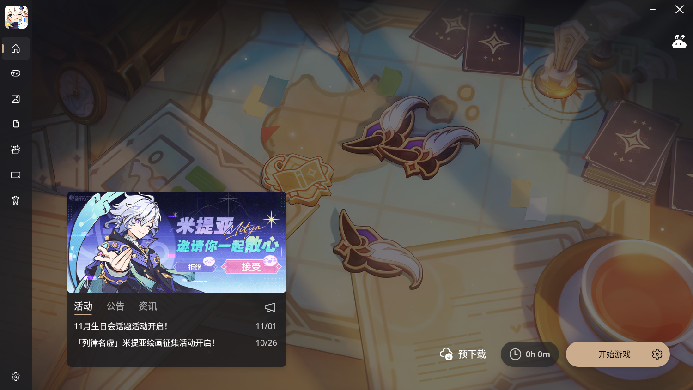
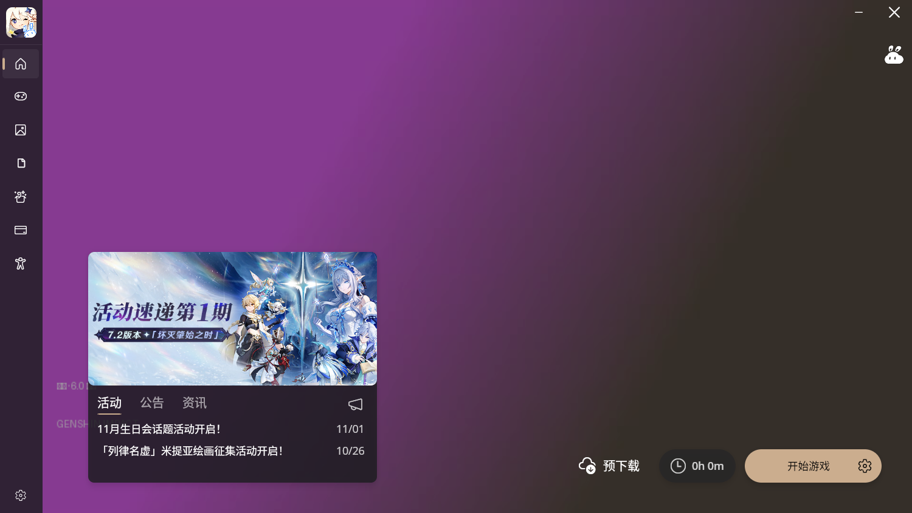
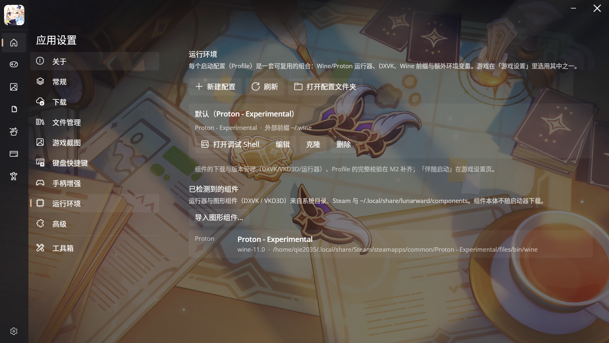
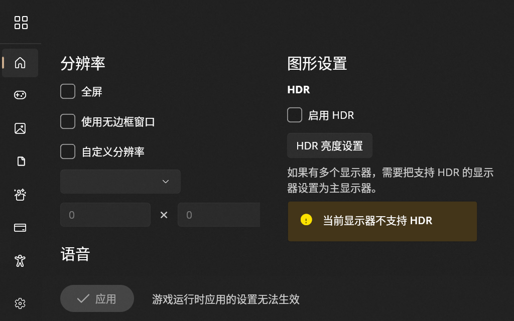
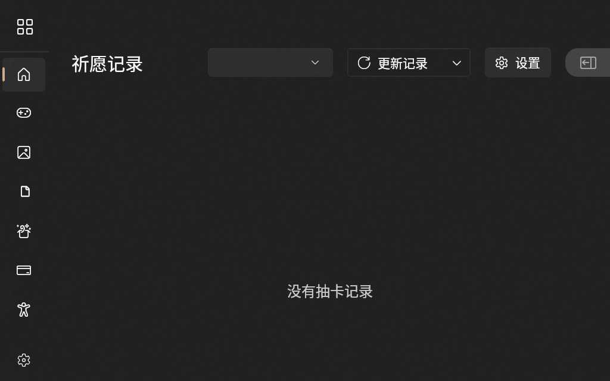
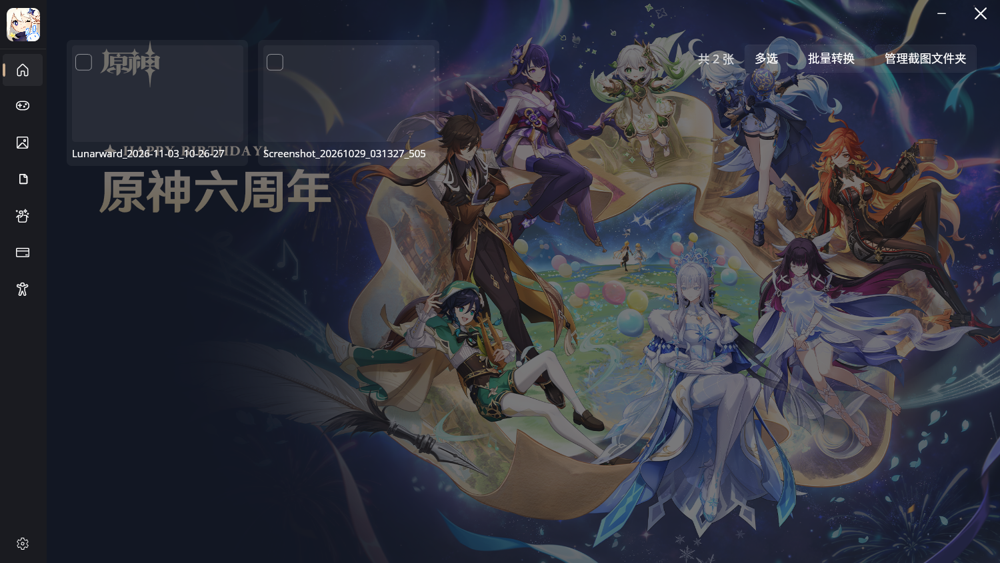
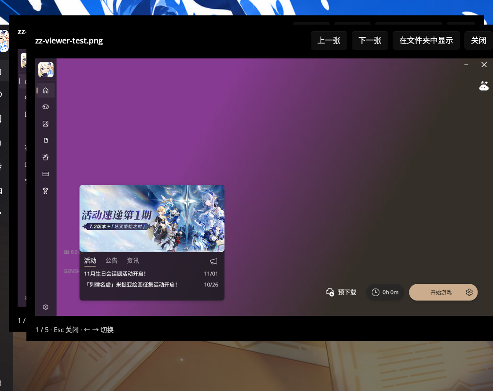

# Lunarward

> [!WARNING]
> **WIP · 开发中，尚未发布可用版本。** 这是一个进行中的 Linux 移植实验项目：主流程（启动、安装/更新、
> 运行环境、截图、壁纸）在作者机器上可用，但**真机验收尚未完成**——真实登录回填、部分游戏的实机启动、
> 托盘图标观感等仍在逐项验证。接口、配置文件格式、CLI 参数都可能在后续提交中变动，暂不建议日常使用。
>
> 本项目是**非官方**移植：与米哈游 / HoYoverse 无关，也与 Starward 作者无关；上游与第三方依赖的
> 引用情况见 [`ATTRIBUTIONS.md`](./ATTRIBUTIONS.md)。

米哈游 / HoYoverse 游戏的 Linux 综合启动器，基于 [Starward](https://github.com/Scighost/Starward)（MIT）的
UI 与业务代码移植而来。目标是把 Starward 的完整功能与观感带到 Linux，同时补上 Linux 特有的
运行环境管理（wine / Proton / DXVK / 前缀）。

> 项目名 **Lunarward**：Starward 的 Linux 对应物。上游 Starward 的说明保留在
> [`docs/README.starward.md`](./docs/README.starward.md)。



## 现在能做什么

| 功能 | 状态 |
| --- | --- |
| 启动器主页（横幅、公告、资讯、开始游戏、游玩时长） | ✅ |
| 自动识别已安装游戏（原神 / 星穹铁道 / 绝区零 / 崩坏3） | ✅ |
| 用 wine / Proton 启动（保住「游戏是 wine 第一个进程」） | ✅ |
| 运行配置（Profile）：运行器、前缀模式（模板 / 专用 / 共享 / 外部 / 一次性）、环境变量 | ✅ |
| 前缀模板与 reflink 克隆（650MB 前缀约 0.1–0.3s） | ✅ |
| DXVK / VKD3D 导入与按前缀安装、启动前自动确保 | ✅ |
| 启动前预检（6 项）+ 启动报告 JSON + 前缀互斥锁 | ✅ |
| 后启动程序 + 伴随启动（三种触发时机）+ 手动启动 | ✅ |
| 调试 Shell（Profile 一键开终端，带同一套环境） | ✅ |
| 输出捕获（游戏与后启动程序 stdout/stderr，落盘 + 面板 + 脱敏） | ✅ |
| 游戏设置（分辨率 / 语音 / 图形，经 wine 注册表） | ✅ |
| 抽卡记录（米游社 / HoYoLAB 登录、UIGF 导入导出） | ✅ 需真实登录验证 |
| 截图：Alt+D 捕获、图库、多选批量转 JPG、查看器 | ✅ 游戏内悬浮待做 |
| 背景壁纸：静态图 + 视频（libvlc 可选） | ✅ |
| 托盘（StatusNotifierItem）、`lunarward://` 协议、单实例转发 | ✅ |
| 全局热键 Alt+S / Alt+D（X11） | 🟡 唤回依赖 xdotool |
| 自更新 | 🟡 走 AUR 版本检查，不自我替换 |
| 安装包（PKGBUILD） | ✅ |
| AppImage | ⬜ |

完整的「哪些是真实现、哪些是替身、缺口在哪个里程碑」见
[`docs/linux-port/12-shims-and-gaps.md`](./docs/linux-port/12-shims-and-gaps.md)。

## 安装

需要 .NET 10 运行时（`dotnet-runtime`），GTK3 与 X11。Arch / CachyOS：

```bash
git clone <本仓库> && cd Lunarward/packaging
makepkg -si
```

其他发行版用发布目录自建包：

```bash
cd src/Lunarward
dotnet publish Lunarward.csproj -c Release -r linux-x64 --self-contained false -o /opt/lunarward
```

再配一份 `packaging/lunarward.desktop` 与图标即可，详见 [`packaging/README.md`](./packaging/README.md)。

### 可选依赖（缺了会降级，不会假成功）

| 组件 | 作用 | 缺失时 |
| --- | --- | --- |
| `wine` / Proton | 启动游戏 | 预检失败并给出修法 |
| `libvlc` | 视频壁纸 | 回退静态壁纸 |
| `xdotool` | 热键唤回最小化窗口 | 退回 `Window.Activate()` |
| `webkit2gtk-4.1` + `python-gobject` | 米游社/HoYoLAB 登录 | 登录页提示助手不可用 |
| `kdialog` / `zenity` | 文件对话框 | 退化为手动输入路径 |
| `spectacle` / `grim` / `gnome-screenshot` | 截图 | 提示没有可用的截图工具 |

## 快速上手

1. **识别游戏**：首次启动会扫 `~/games`、Steam `common` 等目录；识别不到就在左上角「自动查找」里手工指定。
   目录名要与 gameId 一致（`hk4e_cn`、`hkrpg_cn`、`nap_cn`…），因为国服/B 服共用同一个 exe 名。
2. **配运行环境**：设置 → 运行环境。默认会生成一套「Proton Experimental + `~/.wine`」的配置；
   建议把你调好的前缀「做成模板」，之后每个测试组合克隆一份，互不干扰。
3. **绑定配置**：游戏设置 → 运行配置，给每个游戏选一套 Profile。
4. **启动**：主页面「开始游戏」。失败会弹预检明细，成功会写一份启动报告。
5. **辅助工具**：游戏设置 → 后启动程序。需要跟游戏同环境执行的 patch/hook 用「伴随启动」，
   会在游戏起来后立刻跑（默认二次确认，避免误开被判作弊）。

## 排错

先看 [`docs/user/faq.md`](./docs/user/faq.md)。常用自查命令：

```bash
lunarward --preflight hk4e_cn ~/games/hk4e_cn/YuanShen.exe   # 六项检查
lunarward --launch-plan ~/games/hk4e_cn/YuanShen.exe         # 只解析不启动
lunarward --companion-plan hk4e_cn                           # 后启动程序命令行
lunarward --output-tail 200                                  # 最近输出
lunarward --graphics-list                                    # 检测到的运行器与图形组件
```

启动报告：`~/.local/share/lunarward/logs/launch/*.json`；日志：`~/.local/share/lunarward/log/`。

## 界面

| | |
| --- | --- |
|  |  |
|  |  |
|  |  |

## 设计文档

移植的取舍、运行模型、移植矩阵、依赖准入、风险、路线图都在
[`docs/linux-port/`](./docs/linux-port/README.md)。改代码前建议先读
[`00-decisions.md`](./docs/linux-port/00-decisions.md)（D0–D34）与
[`13-lessons.md`](./docs/linux-port/13-lessons.md)（踩过的坑）。

## 许可与致谢

- 本项目沿用上游 **MIT** 许可，见 [`LICENSE`](./LICENSE)（Copyright 2023 Scighost）。
- UI、ViewModel 与绝大部分业务逻辑来自 [Starward](https://github.com/Scighost/Starward)（MIT）；
  本次移植基于上游提交 `df8ae07`（2026-10-12）。上游原版说明保留在
  [`docs/README.starward.md`](./docs/README.starward.md)。
- 运行环境（wine / Proton / DXVK / wineprefix 组织方式）的设计参考了
  [an-anime-team](https://github.com/an-anime-team) 的系列启动器（GPL-3.0，**仅作参考，代码不混合**）。
- 其余依赖（Uno Platform、Hi3Helper.Sophon、LibVLCSharp 等）、运行时外部命令与资源版权归属，
  见 [`ATTRIBUTIONS.md`](./ATTRIBUTIONS.md)。
